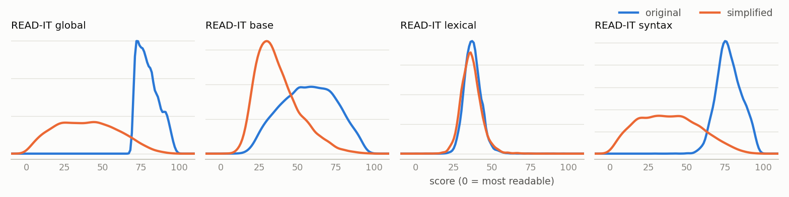
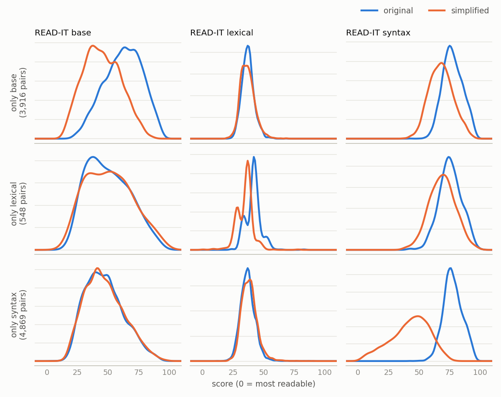

# Dataset v1: three target tokens per pair

Dataset v1 trains a simplifier that is told, for each READ-IT dimension (base, lexical, syntax), either the level to reach or `any`. Every pair starts from a complex original (READ-IT global > 70, like the test sets). Every pair lowers at least one dimension by at least one control token *and* by more than READ-IT's own noise. Each pair is used once, with all three tokens, instead of once per strategy as in v0 and in the CLiC-it 2026 (GFFF) data.

| | |
|---|---|
| Source | Wikipedia part of IMPaCTS on Hugging Face, [`mpapucci/impacts`](https://huggingface.co/datasets/mpapucci/impacts), revision `489c78e` (pinned in [`scripts/impacts.py`](../../scripts/impacts.py)) |
| Training pairs | **78,462** from 10,800 originals: 77,696 `train` + 766 `validation` (column `split`) |
| Test sets | the same 1,000 pairs per strategy as v0 and CLiC-it 2026, with v1 columns added |
| Built by | `python scripts/build_dataset_v1.py` (about 20 s); analysis by `python scripts/analyze_dataset_v1.py` (about 30 s) |
| Explore | [data explorer](https://michelepapucci.github.io/simplification-journal/#data=v1), dataset "v1" |

## Files

| File | Content |
|---|---|
| `training_set_v1.zip` | CSV (19 MB), one row per pair: `idx`, `original_sentence_idx`, `split`, both texts, the eight READ-IT scores, `src_{base,lexical,syntax}` (source levels), `tgt_{base,lexical,syntax}` (target level or `any`), `ctrl_tokens`, then the Profiling-UD features (`*_original`, `*_simplification`, without `n_sentences`) |
| `{base,lexical,syntax}_test_set_v1.csv` | the v0 test pairs, with every v0 column including the Profiling-UD features, plus the v1 columns computed from the reference simplification with the same margins |
| `construction_v1.json` | the rules, the measured noise and margins, and the count after every step |
| `analysis_v1.json`, `figures/` | everything reported under Findings |

Read the target columns as strings, since they mix levels and `any`:

```python
import pandas as pd
v1 = pd.read_csv("data/v1/training_set_v1.zip", dtype={"tgt_base": str, "tgt_lexical": str, "tgt_syntax": str})
train, validation = v1[v1.split == "train"], v1[v1.split == "validation"]
```

## Construction

| Step | Pairs | Originals |
|---|---|---|
| IMPaCTS release, Wikipedia (already without pairs whose READ-IT global went up, and without copies of the original) | 764,061 | 106,680 |
| 1. Hold out the test originals: every pair of the 2,575 originals in the three test sets | 740,563 | 104,105 |
| 2. Keep complex originals: READ-IT global > 70 | 213,703 | 24,355 |
| 3. Remove the pairs on the GFFF langdetect list | 210,720 | 24,313 |
| 4. Remove originals matching the double-filter proxy | 94,560 | 10,866 |
| 5. Remove exact duplicates (same original, same simplification) | 94,505 | 10,866 |
| 6. Measure READ-IT's noise on these pairs, giving one margin per dimension (below) | | |
| 7. Keep pairs with at least one target | **78,462** | **10,800** |
| 8. Split by original: 1% of originals to `validation` (seed 42) | 77,696 + 766 | 10,692 + 108 |

**Steps 2, 4 and 7 are the design.**
- Steps 1, 3 and 5 keep the test sets clean, reuse a known-bad list and remove 55 rows that would count twice.
- The langdetect list only covers the CLiC-it selection, and most of the hard originals are in it. Pairs outside it have never been language-checked.

**Double-filter proxy (step 4).** An original is removed if it contains a double quote, a guillemet, a curly quote or an opening parenthesis (`["«»“”(]`), or if it is longer than 400 characters. This reproduces 92.3% of the GFFF double filter's decisions (see `reports/improving_controllability.md`, Section 0). On complex originals it removes 55% of them, close to the real filter's 51%.

**Targets (step 7).** Every READ-IT score is binned with the CLiC-it rule, level = 10 · ⌊10 · score⌋, capped at 90. For each dimension the target is the simplification's level if both hold:
- that level is **below** the original's (at least one control token lower), and
- the score dropped by **at least the dimension's margin**.

Otherwise the target is `any`. A pair needs at least one target. The control string has a fixed order:

```
<|readability_base_any|><|readability_lexical_30|><|readability_syntax_20|>
```

That is 33 tokens: the 30 existing level tokens plus `<|readability_{base,lexical,syntax}_any|>`. Level 90 never appears as a target.

### How the noise margin is computed

READ-IT is a classifier's output, so it moves even when the text barely changes. The margin is that movement, measured on the data itself:

1. Within each original, take every two of its simplifications that are near-identical: character similarity ≥ 0.9 by Python's `difflib.SequenceMatcher(...).ratio()`, but not identical. The v1 pool has 45,445 such pairs, for example the same sentence with one word changed or a comma removed.
2. For each such pair and each dimension, take the absolute difference of their READ-IT scores (0–100). Near-identical texts should score nearly the same, so these differences are READ-IT's noise. The estimate is conservative, since some of these small edits are real.
3. The margin is the 90th percentile of those differences. A drop counts only if it is larger than what 90% of near-identical rewrites produce.

| Points of READ-IT difference between near-identical simplifications | median | 75th pct | **90th pct (margin)** | 95th pct |
|---|---|---|---|---|
| base | 1.6 | 3.3 | **5.7** | 8.1 |
| lexical | 1.1 | 2.2 | **3.8** | 5.1 |
| syntax | 3.5 | 9.0 | **17.6** | 24.5 |

The margin is about two control tokens for syntax and half a token for base and lexical: READ-IT syntax jumps far more than the other two on small edits. In your example (75 → 69, one token down by 6 points), the pair is a target for base and lexical, but `any` for syntax, where 6 points is within READ-IT's noise. The margins are recomputed on every build and stored in `construction_v1.json`.

**What `any` means.** In the raw data, `any` means "this dimension did not drop beyond noise": it stayed in its bin, went up, or dropped by less than the margin.

| Dimension | Target set | Same bin | Bin lower, drop under the margin | Higher bin |
|---|---|---|---|---|
| base | 78.9% | 13.5% | 3.1% | 4.5% |
| lexical | 19.6% | 60.8% | 5.1% | 14.5% |
| syntax | 87.7% | 3.1% | 8.9% | 0.3% |

## Findings

### 1. Size and sources

| | v0 (CLiC-it selection) | v1 |
|---|---|---|
| Training pairs | 55,877 (each × 3 strategies) | 78,462 (each once, three tokens) |
| Originals | 11,657 | 10,800 |
| Source READ-IT global, quartiles | 74 / 78 / 83 | 74 / 79 / 85 |
| Original length, median characters | 200 | 200 |
| Pairs with a READ-IT score higher than the source | none | 46% (35,758 pairs), labelled `any` for that dimension; one per original: lexical 41%, base 10%, syntax 1% |

v1 starts from the same kind of originals as v0, and as the test sets. It differs from v0 in three ways:
- it keeps the generator's trade-off pairs;
- it ignores drops within READ-IT's noise;
- it gives every pair three tokens.

<picture>
  <source media="(prefers-color-scheme: dark)" srcset="figures/readit_kde_dark.png">
  
</picture>

*READ-IT distributions of the originals and of one simplification per original (10,800 pairs; Gaussian KDE, Scott bandwidth).* The mean drop is 40 points global, 20 base and 39 syntax. Lexical moves by 1 point on average, because 41% of the simplifications score *higher* on lexical.

### 2. What the pairs target

| Dimensions targeted | Pairs | Share |
|---|---|---|
| base + syntax | 41,650 | 53.1% |
| syntax only | 14,233 | 18.1% |
| base + lexical + syntax | 11,474 | 14.6% |
| base only | 7,186 | 9.2% |
| base + lexical | 1,620 | 2.1% |
| lexical + syntax | 1,456 | 1.9% |
| lexical only | 843 | 1.1% |

### 3. Target levels

| Level | base v1 | base v0 | lexical v1 | lexical v0 | syntax v1 | syntax v0 |
|---|---|---|---|---|---|---|
| 0 | 57 | 69 | 14 | 5 | 5,295 | 4,054 |
| 10 | 4,775 | 5,251 | 255 | 330 | 11,376 | 8,360 |
| 20 | 19,557 | 16,833 | 6,914 | 12,101 | 13,207 | 8,953 |
| 30 | 19,247 | 15,186 | 7,606 | 36,043 | 13,755 | 8,884 |
| 40 | 10,587 | 8,979 | 574 | 7,044 | 12,960 | 8,134 |
| 50 | 4,795 | 4,780 | 27 | 315 | 8,577 | 6,760 |
| 60 | 2,132 | 2,617 | 2 | 31 | 3,131 | 5,704 |
| 70 | 704 | 1,395 | 1 | 5 | 512 | 3,762 |
| 80 | 76 | 595 | 0 | 3 | 0 | 1,250 |
| 90 | 0 | 172 | 0 | 0 | 0 | 16 |
| **total** | **61,930** | 55,877 | **15,393** | 55,877 | **68,813** | 55,877 |

Every v1 target is a real drop. Every v0 token labels a pair whether or not that dimension moved, so v0's higher levels are mostly "unchanged" pairs. Per dimension:

| | Steps down from the source level (1 / 2 / 3 / 4+) | Distinct target levels per original | Originals with one level only |
|---|---|---|---|
| base | 26% / 26% / 22% / 26% | 2.37 | 21% |
| lexical | 94% / 5% / 0.4% / 0.2% | 1.09 | 91% |
| syntax | 0.5% / 13% / 19% / 68% | 3.32 | 7% |

- **Syntax** has large, varied drops and many levels per original: the best-supported dimension.
- **Lexical** is the weak one: 15,393 targets, almost all one level below the source, at levels 20–30.

### 4. "any" and the dimensions travel together

| Given a pair targets … | … it also targets base | … lexical | … syntax | … nothing else |
|---|---|---|---|---|
| base | | 21.1% | 85.8% | 11.6% |
| lexical | 85.1% | | 84.0% | 5.5% |
| syntax | 77.2% | 18.8% | | 20.7% |

The CLiC-it test protocol asks for one strategy at a time. In v1 that request reads `<|readability_base_any|><|readability_lexical_30|><|readability_syntax_any|>`, and in the raw data that string means "lower lexical, and nothing else beyond noise". Only 5.5% of lexical-targeted pairs look like that.

**Use attribute dropout during training.** Independently replace each set target with `any` (p ≈ 0.3, at least one target kept), re-drawn every epoch. `any` then means "unspecified", and the one-strategy requests mean what they meant for the CLiC-it models.

### 5. Single-dimension pairs show distinct linguistic profiles

These are the CLiC-it 2025 analyses on Profiling-UD features, with one simplification per original (seed 42). *r* is the matched-pairs rank-biserial correlation on original minus simplified: *r* > 0 means the feature is higher in the original.

| | only base | only lexical | only syntax | all three |
|---|---|---|---|---|
| Pairs (one per original) | 3,916 | 548 | 4,869 | 4,627 |
| READ-IT drop, base / lexical / syntax (points) | 17.1 / 0.3 / 9.5 | −0.7 / 6.9 / 6.5 | −0.1 / −1.3 / 34.8 | 29.0 / 8.1 / 48.4 |
| Pillai's *V* (chance) | 0.32 (0.02) | 0.30 (0.12) | 0.28 (0.01) | 0.64 (0.01) |
| `n_tokens` | 0.98 | −0.37 | 0.31 | 0.99 |
| `char_per_tok` | −0.01 | 0.21 | 0.45 | −0.12 |
| `in_dict` (basic-vocabulary share) | 0.06 | −0.50 | −0.07 | 0.01 |
| `in_FO` (fundamental-vocabulary share) | −0.05 | −0.38 | −0.08 | −0.16 |
| `lexical_density` | −0.13 | 0.00 | 0.46 | −0.34 |
| `avg_max_depth` | 0.79 | −0.14 | 0.53 | 0.93 |
| `max_links_len` | 0.75 | −0.09 | 0.07 | 0.89 |
| `verbal_head_per_sent` | 0.90 | −0.21 | 0.51 | 0.92 |
| `subordinate_proposition_dist` | 0.64 | −0.13 | 0.63 | 0.85 |
| `n_prepositional_chains` | 0.82 | −0.45 | −0.11 | 0.83 |

- **Only lexical** is genuine lexical simplification. The simplifications use shorter words and clearly more basic and fundamental vocabulary (`in_dict` −0.50, `in_FO` −0.38), are *longer* (`n_tokens` −0.37), and keep their tree depth and subordination. Among feature categories, lexical variety moves far more (mean |*r*| 0.39) than parse-tree structure (0.16) or subordination (0.12). The pool is thin, though: 843 pairs, and its MANOVA chance level is 0.12.
- **Only syntax** reshapes the tree (depth, verbal heads, subordination, all 0.5–0.6) without changing vocabulary (`in_dict`, `in_FO` |*r*| < 0.1). Its strongest features are auxiliaries (`aux_tense_dist_Pres` −0.77, `dep_dist_aux` −0.74): copulas and compound or passive forms replace other constructions, as in the passive example below.
- **Only base** is shortening (`n_tokens` 0.98), which also flattens the tree.
- **All three** is the strongest rewrite (*V* 0.64).

"Only" means the other two dimensions did not drop *beyond noise*. With a 17.6-point margin, "only base" and "only lexical" pairs still lose 6–10 syntax points on average.

<picture>
  <source media="(prefers-color-scheme: dark)" srcset="figures/single_target_kde_dark.png">
  
</picture>

*Pairs that lower a single dimension. Rows: the targeted dimension; columns: the READ-IT dimension plotted.* The targeted dimension shifts. Base and lexical stay put off the diagonal, while syntax moves a little, by less than its margin.

Examples, picked at random (seed 42) among originals of 80–170 characters:

| Pattern | Original → simplification |
|---|---|
| only lexical | *E lì dà vita ad una divisione chiamata specializzata nella consulenza gestionale.* → *E lì inizia una divisione …* (lexical 47.6 → 37.7) |
| only lexical | *L'istituto non va confuso, come a volte succede, con la preesistente imposta patrimoniale del catasto, introdotta qualche anno prima:* → *Istituto di imposta patrimoniale del 1909 non va confuso con …* (lexical 42.3 → 33.2). The year 1909 is not in the source: a hallucination. |
| only syntax | *Gran cacciatore di pernici, trascinò nei suoi vagabondaggi l'amico Onorato Carlandi.* → *Onorato Carlandi fu trascinato nei suoi vagabondaggi da un grande cacciatore di pernici.* (syntax 71.6 → 3.2) |
| only syntax | *Questo pose lo Xinjiang sotto il pieno controllo politico ed economico dei sovietici, rendendolo parte della Cina solo nominalmente.* → *Ciò ha posto … dei sovietici rendendolo … nominalmente* (syntax 77.6 → 52.3). It loses a comma and the final period, and syntax still drops 25 points: noise beyond the 90th percentile gets through. |
| only base | *Tim, non voleva che abortisse, per cui le fu molto vicino, persino accompagnandola ad un corso pre-parto col nome fittizio di Alvin Draper.* → the same without the final phrase (base 45.0 → 35.8) |

### 6. Comparison with CLiC-it 2025 and the GFFF data

The same code ([`scripts/build_webview_data.py`](../../scripts/build_webview_data.py)), one simplification per original, ran on five datasets:
- the Wikipedia sample of the CLiC-it 2025 paper;
- the GFFF training file the CLiC-it 2026 models used;
- v0;
- v1;
- v1 without its trade-off pairs.

The explorer shows the first, third and fourth side by side.

| | CLiC-it 2025 sample | GFFF (CLiC-it 2026) training | v0 | **v1** | v1 without trade-off pairs |
|---|---|---|---|---|---|
| Pairs / originals | 14,293 / 2,000 | 45,209 / 11,464 | 55,877 / 11,657 | 78,462 / 10,800 | 42,704 / 9,675 |
| Originals: mean READ-IT global; median characters | 49; 144 | 79; 199 | 79; 200 | 80; 200 | 80; 200 |
| Mean drop, global / base / lexical / syntax | 22.5 / 13.1 / 1.7 / 21.6 | 36.6 / 21.1 / 3.9 / 34.5 | 39.0 / 21.9 / 4.1 / 36.8 | 40.1 / 19.9 / 1.0 / 39.2 | 41.7 / 22.9 / 4.1 / 39.7 |
| Pairs with READ-IT lexical higher | 40% | 0% | 0% | 41% | 0% |
| Pillai's *V*: random / most / least simplified | 0.25 / 0.44 / 0.13 | 0.42 / 0.55 / 0.26 | 0.45 / 0.58 / 0.28 | 0.46 / 0.62 / 0.29 | 0.50 / 0.60 / 0.38 |
| `n_tokens` | 0.88 | 0.97 | 0.97 | 0.93 | 0.98 |
| `char_per_tok` | 0.15 | 0.01 (n.s.) | 0.01 (n.s.) | 0.15 | 0.01 (n.s.) |
| `lexical_density` | 0.07 | −0.14 | −0.12 | 0.04 | −0.13 |
| `upos_dist_PUNCT` | 0.35 | 0.33 | 0.33 | 0.13 | 0.31 |
| `avg_token_per_clause` | 0.32 | 0.12 | 0.13 | 0.05 | 0.12 |
| `avg_max_depth` | 0.81 | 0.88 | 0.88 | 0.87 | 0.90 |
| `principal_proposition_dist` | −0.61 | −0.76 | −0.76 | −0.77 | −0.77 |
| `subj_pre` | −0.03 (n.s.) | −0.23 | −0.25 | −0.23 | −0.25 |
| `upos_dist_PROPN` | −0.15 | −0.38 | −0.37 | −0.32 | −0.38 |
| `upos_dist_ADP` | 0.17 | 0.34 | 0.32 | 0.32 | 0.36 |

**The method reproduces the 2025 analysis.** On the 2025 sample, our MANOVA gives Pillai's *V* = 0.438 for the most simplified and 0.125 for the least simplified version. The 2025 analysis notebook (`code/notebooks/analysis/manova.ipynb`) has 0.439 and 0.124. For "random" it has 0.179, because it took the first simplification of each original rather than a random non-extreme one, which gives 0.249.

**Differences that come from starting with complex sentences** (2025 sample vs every CLiC-it 2026 dataset, v1 included):
- **The simplifications change more.** Mean drops nearly double (global 22 → 37–40 points) and Pillai's *V* rises from 0.25 to 0.42–0.46.
- **Syntactic effects grow.** Principal clauses are shared more widely (`principal_proposition_dist` −0.61 → −0.77). Prepositions and obliques are cut more (`upos_dist_ADP` 0.17 → 0.32–0.36). Subjects move before the verb (`subj_pre` −0.03, n.s. → −0.23).
- **Clause length barely changes** (`avg_token_per_clause` 0.32 → 0.05–0.13). Hard sentences are simplified by splitting and restructuring clauses, not by shortening each one.
- **Proper nouns make up more of what remains** (`upos_dist_PROPN` −0.15 → −0.32 to −0.38).

**Differences that come from the GFFF filter, and that v1 undoes.**
- **What the filter removed.** "No READ-IT score higher than the source" removed about 40% of the generator's outputs, mostly ones where READ-IT lexical went up.
- **Those pairs carry the generator's lexical simplification.** With them (2025 sample, v1), words get shorter (`char_per_tok` 0.15) and lexical density does not rise. Without them (GFFF, v0, v1 without trade-offs), word length does not change (0.01, n.s.) and simplifications become lexically *denser* (−0.12 to −0.14). They also remove less punctuation (`upos_dist_PUNCT` 0.13 vs 0.31–0.33).
- **The GFFF data's lexical profile is a selection artefact.** v1 without its trade-off pairs reproduces the GFFF values almost exactly.
- **READ-IT lexical disagrees with the usual lexical indicators** on a large share of the generator's outputs: it rises on the pairs whose words get shorter. That is worth understanding before relying on lexical as a control dimension.

### 7. Weak spots

- **Lexical is thin.** It has 15,393 targets: 94% are one level down and 91% of originals reach a single lexical level. Lexical-only pairs number 843. 16.9% of lexical targets rest on drops between the margin (3.8) and 5 points. Across all pairs, 1.6% are near-copies (similarity ≥ 0.95).
- **Some test requests fall outside the training rule.** Of the paper's requests (every test original × CT 10–70), these are requests v1 could have produced as a training target (below the source level, and by at least the margin):

  | Strategy | Within the training rule | Below the source level |
  |---|---|---|
  | base | 96.8% | 96.8% |
  | lexical | 40.9% | 40.9% |
  | syntax | 87.8% | 98.0% |

  For a v1 model, the remaining requests are undefined. For lexical they are at or above the source. For syntax they are less than 17.6 points below it. Score those separately.
- **The proxy removes long and parenthesised inputs entirely.** v1 originals are at most 400 characters and contain no quotes or parentheses. The base test set is long: median 338 characters, 16.4% above 400 (lexical 1.4%, syntax 1.7%).
- **Language check.** Only the CLiC-it selection went through langdetect, and v1 includes trade-off pairs that were outside it. It flagged 2.2% of the selection.

## For the first training run (0.6B)

1. **Attribute dropout** (Section 4). Without it, the one-strategy test requests ask for something the data rarely shows.
2. **Tokenizer and initialisation.** Register the 33 tokens. Initialise the new embeddings by token id: `convert_tokens_to_ids`, not `rows − num_added`, which is off by the `pad_to_multiple_of=8` padding in the GFFF script.
3. **Validation split.** Use the `split` column for validation. The GFFF script takes the last rows by `idx`, which shares originals with training.
4. **Evaluation.** Report lexical and syntax separately for requests inside and outside the training rule (Section 7).
5. **Budget.** An epoch of v1 is 77,696 examples, against 135,627 (45,209 × 3) for a CLiC-it run. Match training steps, not epochs, when comparing with the CLiC-it models.

The prompt can stay `f"{ctrl_tokens}\n{original_text}\n"`.
